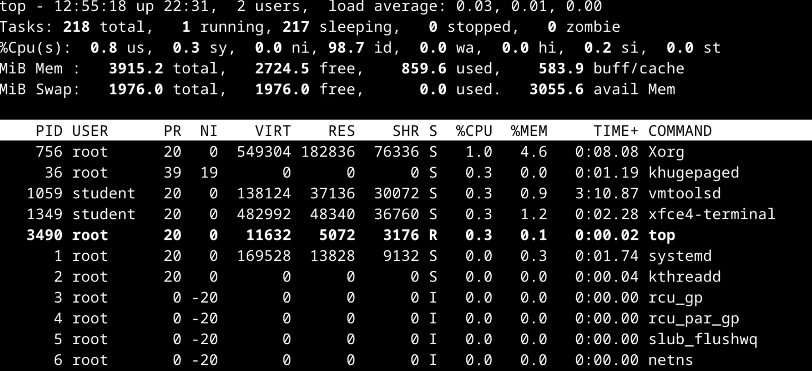
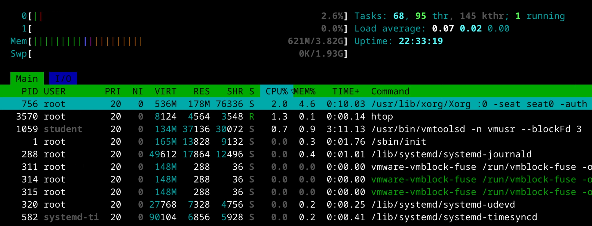
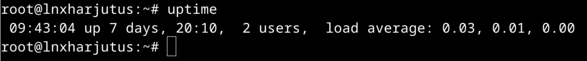
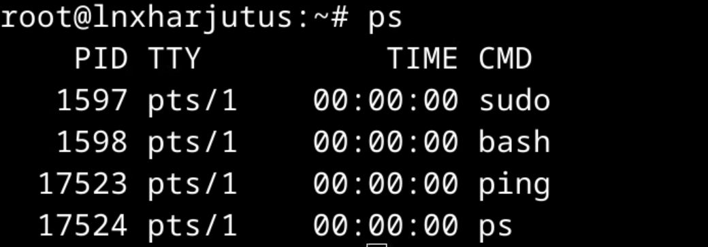
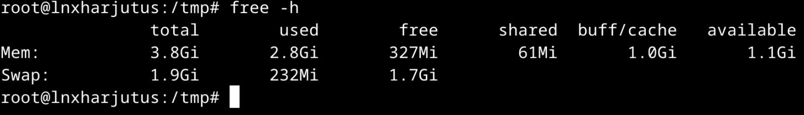
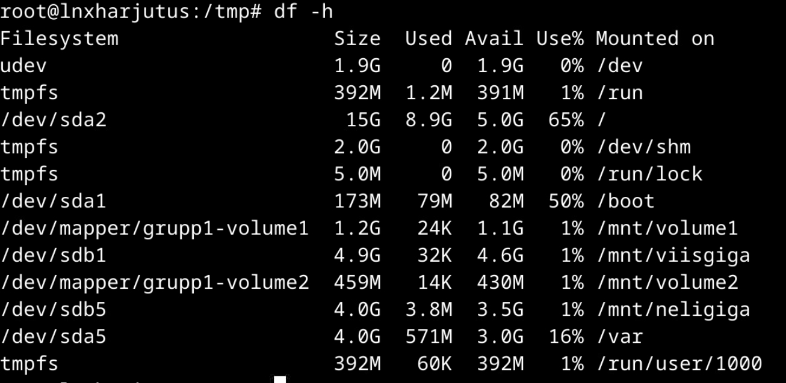
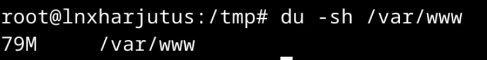
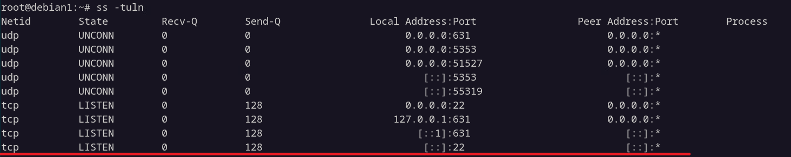
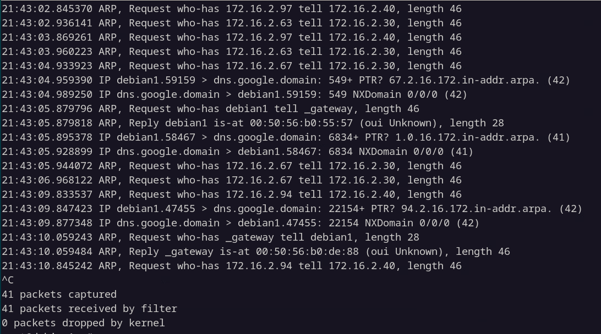

# Linuxi süsteemi monitooring

**Monitooring** ehk **seire** tähendab süsteemi seisundi ja muutuste jälgimist. Linuxi serveris uurime näiteks protsessori kasutust, mälu, kettaruumi, võrguühendusi ning teenuste tööd. Eesmärk on märgata probleemi, leida selle põhjus ja kontrollida, kas lahendus aitas. Regulaarne monitooring aitab IT-spetsialistidel ennetada probleeme enne, kui need muutuvad tõsisteks.

Materjali käsunäited lähtuvad **Debian 13** süsteemist. 

!!! info "Õpieesmärgid"

    Pärast materjali läbimist oskad:

    - selgitada, miks serveri ressursse ja teenuseid jälgitakse;
    - eristada protsessori kasutusprotsenti ja koormuskeskmist;
    - leida suure ressursikasutusega protsessi ning uurida selle seost teenusega;
    - tõlgendada mälu ja kettaruumi kasutuse põhinäitajaid;
    - valida võrguühenduste ja pakettide uurimiseks sobiva tööriista;
    - selgitada signaalide ning protsessi nice-väärtuse eesmärki;
    - leida logidest asjakohase veateate ja kontrollida paranduse tulemust.

## 1. Miks serverit jälgida?

Server võib korraga pakkuda näiteks veebiteenust, andmebaasi ja failide jagamist. Need kasutavad samu ressursse. Kui üks teenus nõuab ootamatult palju protsessoriaega või salvestusruum saab täis, võivad kannatada ka teised teenused.

| Mida jälgime? | Millisele küsimusele vastust otsime? |
| --- | --- |
| **Protsessor — CPU** | Kas protsessoril jätkub aega vajalike tööde jaoks? |
| **Mälu — RAM ja swap** | Kas rakenduste tööks on piisavalt mälu? |
| **Kettaruum** | Kas failide, andmebaaside ja logide jaoks jätkub ruumi? |
| **Võrk** | Millised ühendused on olemas ja kas andmed liiguvad? |
| **Protsessid ja teenused** | Mis töötab, kelle õigustes ja millise ressursikasutusega? |
| **Logid** | Millised sündmused või vead selgitavad probleemi? |

**Kitsaskoht** (*bottleneck*) on tegur, mis piirab süsteemi jõudlust. See võib olla näiteks protsessor, salvestusseadme aeglus või rakenduse seadistus.

Kõrge näitaja ei tähenda alati riket. Varundamine võib ajutiselt suurendada koormust ja Linux kasutab osa vabast mälust vahemäluna. Ka ebatavaline võrguliiklus ei tõesta üksinda rünnakut. Näitajat tuleb võrrelda serveri tavapärase töö ja samal ajal toimuvate tegevustega.

!!! example "Mõõda, selgita, kontrolli"

    Veebiteenus on aeglane. Kõrge CPU kasutuse nägemine on tähelepanek. Selle põhjustava protsessi leidmine täpsustab probleemi. Kui põhjuseks osutub vigane seadistus, parandatakse seda ning mõõdetakse uuesti. Alles siis saab hinnata, kas lahendus aitas.

## 2. Tööriistad ja nende kasutamine

**Utiliit** on kindla ülesande täitmiseks mõeldud tööriist. Osa utiliite annab hetkeülevaate, osa uuendab näitu jooksvalt. Pikemaajaline seire kogub mõõtmisi aja jooksul ja võimaldab muutusi võrrelda.

| Eesmärk | Tööriistad |
| --- | --- |
| Süsteemi koondvaade ja protsessid | `top`, `htop`, `uptime`, `ps` |
| Protsesside leidmine ja mõjutamine | `pgrep`, `kill`, `pkill`, `nice`, `renice` |
| Mälu kasutus | `free` |
| Failisüsteemi ja kataloogide ruumikasutus | `df`, `du` |
| Võrguliidesed, ühendused ja liiklus | `ip`, `ss`, `tcpdump` |
| Teenuste olek ja süsteemilogid | `systemctl`, `journalctl` |
| Tekstipõhiste logide lugemine | `less`, `tail`, `grep` |

### 2.1. Millised paketid on vajalikud?

Minimaalses süsteemis ei pruugi kõik tööriistad olla paigaldatud. Näiteks `top`, `ps`, `free`, `uptime`, `pgrep` ja `pkill` kuuluvad paketisse `procps`; `htop` ja `tcpdump` on eraldi paketid. Vajaduse korral saab need paigaldada:

```bash
sudo apt update
sudo apt install procps htop iproute2 tcpdump less
```

### 2.2. Näidete lugemine

Materjalis on `1234` **näidis-PID**, mitte käsk lõpetada mõni konkreetne protsess sinu serveris. Samuti tuleb nimed `myapp`, `naidis.service`, võrguliides `ens192` ja näitlikud failiteed asendada oma süsteemi tegelike väärtustega.

Lugemiskäsud ei vaja alati haldusõigusi. Teiste kasutajate protsesside mõjutamine, osa logide lugemine ja pakettide hõivamine võivad vajada `sudo` kasutamist.

## 3. Protsessori ja protsesside jälgimine

### 3.1. top ja htop

`top` ja `htop` näitavad jooksvalt protsesse ning ressursikasutust. Mõlemad töötavad terminalis. `htop` kasutab värve ja ribasid, kuid ei vaja graafilist töölauakeskkonda.

```bash
top
```
{ width="90%" }


```bash
htop
```




| Väli | Tähendus |
| --- | --- |
| **PID — process ID** | Protsessi tunnusnumber. |
| **USER** | Kasutaja, kelle õigustes protsess töötab. |
| **%CPU / CPU%** | Protsessori kasutus vastava tööriista mõõtmisviisi järgi. |
| **%MEM / MEM%** | Protsessile arvestatud füüsilise mälu osakaal. |
| **RES** | Protsessi kasutatav füüsilises mälus paiknev mälu, sealhulgas võimalikud jagatud lehed. |
| **VIRT** | Protsessi virtuaalse aadressiruumi maht; ei võrdu kasutatud RAM-iga. |
| **NI** | Protsessi nice-väärtus. |
| **COMMAND / Command** | Programmi nimi või käsurida. |

`top`-is saab tavaliselt vajutada `P`, et sorteerida CPU kasutuse järgi, `M`, et sorteerida mälu järgi, ning `1`, et vahetada CPU koondvaadet ja üksikute loogiliste protsessorite vaadet. Väljumiseks vajuta `q`. `htop`-i sortimisvalikud leiab näiteks klahviga `F6` ning abi klahviga `F1`. 

Erista **kogu süsteemi** ja **ühe protsessi** kasutusnäitu. Paljudes tavapärastes protsessivaadetes tähendab protsessi 100% ligikaudu ühe loogilise protsessori täielikku kasutamist. Mitme lõimega protsess võib näidata ka üle 100%; täpne esitus sõltub tööriistast ja seadistusest. 

**Näide:** nelja vCPU-ga virtuaalmasinas kasutab üks protsess ühe vCPU täielikult ära. Selle protsessi näit võib olla ligikaudu 100%, kuid kogu masina CPU koondkasutus ligikaudu 25%.

Seetõttu ei piisa järeldusest „näen 100%, järelikult on kogu server üle koormatud”. Uuri protsessorite arvu, näidu tähendust, koormuse kestust ja teenuse käitumist.

### 3.2. uptime

```bash
uptime
```

Käsk näitab muu hulgas süsteemi tööaega ja **koormuse keskmisi väärtusi** (*load average*) viimase **1, 5 ja 15 minuti** kohta.

Näidisväljund:

{ width="80%" }

Koormuste keskmine arvestab Linuxis nii töötavaid või CPU aega ootavaid töid kui ka katkestamatus ooteolekus töid, näiteks teatud sisend-väljundi ootamisi. **See ei ole CPU kasutusprotsent.**

Nelja loogilise protsessoriga süsteemis ei tähenda koormuskeskmine `2.10` üksinda, et kogu CPU võimekus oleks ammendatud. Samuti võib kõrge koormuskeskmine koos tagasihoidliku CPU kasutusega suunata uurima sisend-väljundi ootamist.

Väärtusi võrreldes saab märgata suunda. Näites on ühe minuti keskmine suurem kui 15 minuti keskmine: hiljutine koormus on varasemast kõrgem. Pärast parandust langevad pikema ajavahemiku keskmised järk-järgult.

### 3.3. ps: protsesside hetkeülevaade

`ps` kuvab valitud protsesside kohta **hetkeülevaate**. Ilma valikuteta ei näita see kõiki süsteemi protsesse. 

{ width="50%" }


```bash
ps aux
```

Siin kasutatakse BSD-stiilis valikuid ilma sidekriipsuta. Väljund sisaldab muu hulgas kasutajat, PID-d ja käsurida.

CPU kasutuse järgi sorteeritud vaade:

```bash
ps -eo pid,user,ni,pcpu,pmem,args --sort=-pcpu | head -n 11
```

Näide kuvab päise ja kuni kümme protsessi. `ps`-i CPU protsent põhineb üldjuhul protsessi eluea CPU aja ja möödunud aja suhtel, mistõttu see ei pea ühtima `top`-i viimase mõõtmisvahemiku näiduga. 

Kui käsureal on ainult nimi `python3`, uuri argumente: eri skriptid võivad töötada sama tõlgendaja kaudu.

## 4. Protsessi mõjutamine ja prioriteet

### 4.1. kill saadab signaali

`kill` saadab protsessile **signaali**. Käsk ei tähenda alati sunniviisilist lõpetamist ega programmi taaskäivitamist.

| Signaal | Eesmärk |
| --- | --- |
| **SIGTERM (15)** | Palub protsessil lõpetada. Programm saab lõpetamisele reageerida. |
| **SIGKILL (9)** | Sunnib protsessi lõpetama; programm ei saa signaali püüda ega lõpetamisel koristustoiminguid teha. |
| **SIGSTOP** | Peatab protsessi täitmise. |
| **SIGCONT** | Lubab peatatud protsessil jätkata. |

Vaikimisi saadab `kill` signaali SIGTERM:

```bash
kill 1234
```

Sama kavatsust saab väljendada nimega:

```bash
kill -TERM 1234
```

`kill -KILL 1234` on jõulisem võte, mitte esimene tavapärane samm. Signaali edukas saatmine ei tõenda, et rakendus lõpetas töö veatult või et probleemi põhjus kadus. 

### 4.2. pgrep ja pkill

`pgrep` leiab tingimustele vastavaid protsesse; `pkill` saadab sobivatele protsessidele signaali. Vaikimisi on otsingumuster regulaaravaldis, mitte alati täpne nimi. `-x` nõuab terviklikku nimevastet. 

Kõigepealt vaata, mis sobib:

```bash
pgrep -a -x myapp
```

Seejärel saab vajaduse korral saata sama täpse nimega protsessidele SIGTERM-i:

```bash
pkill -TERM -x myapp
```

`-u student` piirab valikut kasutajaga `student`. Ka täpsele nimele võib vastata mitu protsessi; näiteks üldise nime `python3` järgi mõjutamine võib tabada mitut erinevat rakendust. 

### 4.3. nice ja renice

**Nice-väärtus** mõjutab tavapärase protsessoriaja jagamise suhtelist eelistust. Vahemik on **−20 kuni 19**: väiksem arv tähendab suuremat eelistust, suurem arv väiksemat. Tavapärane lähteväärtus on 0. See ei ole reaalajalise prioriteedi seadistus.

`nice` käivitab programmi muudetud nice-väärtusega:

```bash
nice -n 10 ./arvutus.sh
```

Valik `-n 10` suurendab päritud nice-väärtust kümne võrra; tavapärasest nullist saab 10.

`renice` muudab juba töötava protsessi väärtust:

```bash
renice 10 -p 1234
```

Näites määratakse nice-väärtuseks 10. Tavakasutaja saab üldjuhul oma protsessi eelistust vähendada; selle suurendamine võib vajada haldusõigusi. 

!!! tip "Prioriteet ei ole CPU kasutuspiirang"

    Nice-väärtuse suurendamine ei määra protsessile kindlat CPU protsenti. Kui teised tööd protsessorit ei vaja, võib ka väiksema eelistusega protsess kasutada palju CPU aega. Pideva töötsükli seadistusviga tuleb parandada selle põhjuse juures.

## 5. Mälu kasutuse jälgimine

```bash
free -h
```
{ width="75%" }

`free` näitab füüsilise mälu ja swap'i kasutust. `-h` muudab ühikud inimloetavaks.

| Väli | Kuidas seda mõista? |
| --- | --- |
| **total** | Süsteemile kasutatav kogumaht. |
| **used** | Kasutatud või hetkel mittekättesaadav mälu. |
| **free** | Täielikult kasutamata mälu. |
| **buff/cache** | Puhvrite ja vahemälu kasutus. |
| **available** | Hinnang, kui palju mälu saab uute rakenduste jaoks kasutada ilma swap'imiseta. |

Linux kasutab mälu ka andmete vahemällu hoidmiseks. Seetõttu ei tähenda väike `free` väärtus automaatselt mälupuudust. Uuri eelkõige `available` väärtust, selle muutumist ja rakenduste käitumist. 

**Swap** on mehhanism, kuhu saab paigutada mälulehti väljapoole tavapärast RAM-i tööala, näiteks kettal olevasse swap-faili või -partitsiooni. Swap ei muuda ketast sama kiireks kui RAM. Üksnes kasutatud swap'i olemasolu ei tõenda parajasti toimuvat mälupuudust.

## 6. Kettaruumi jälgimine

### 6.1. df: failisüsteemi ruum

```bash
df -hT
```

`df` näitab failisüsteemide ruumikasutust; `-T` lisab tüübi. See ei ole kõigi füüsiliste ketaste ja nende terviseseisundi loetelu.

{ width="60%" }


| Väli | Tähendus |
| --- | --- |
| **Filesystem** | Failisüsteemi allikas. |
| **Type** | Failisüsteemi tüüp. |
| **Size** | Kogumaht. |
| **Used** | Kasutatud ruum. |
| **Avail** | Saadaval ruum. |
| **Use%** | Kasutuse osakaal. |
| **Mounted on** | Ühenduspunkt kataloogipuus. |

Konkreetse asukoha failisüsteemi saab uurida nii:

```bash
df -h /var/log
```

See näitab failisüsteemi, millel `/var/log` paikneb, mitte logikataloogi enda mahtu. `-h` kasutab 1024-põhiseid kordühikuid, kuigi GNU `df` tähistab neid näiteks tähtedega `M` ja `G`. 

### 6.2. du: failide ja kataloogide ruum

`du` aitab uurida, millised kataloogid ruumi kasutavad. 

```bash
sudo du -sh /var/log
```

`-s` kuvab koondmahu ja `-h` inimloetava suuruse.

{ width="50%" }


Ühe taseme kaupa uurimiseks:

```bash
sudo du -h --max-depth=1 /var/log
```

Suuremate kirjete lõppu järjestamiseks:

```bash
sudo du -h --max-depth=1 /var/log | sort -h
```

**df vastab küsimusele „kui palju ruumi on failisüsteemil?”, du küsimusele „kui palju ruumi kasutavad need failid ja kataloogid?”.** Nende tulemused ei pea olema identsed: näiteks võib kustutatud faili ruum olla endiselt kasutusel, kuni mõni protsess hoiab faili avatuna.

## 7. Võrgu jälgimine

### 7.1. Liides ja liiklusloendurid

Liideste nimede ja aadresside kiire ülevaade:

```bash
ip -brief address
```

Konkreetse liidese liiklusloendurid:

```bash
ip -s link show dev ens192
```

**RX** tähistab vastuvõetud ja **TX** saadetud liiklust. Vaata baite, pakette ning vigade ja kõrvalejäetud pakettide loendureid. Need on kogunevad loendurid, mitte automaatselt kiirus baitides sekundis. Kiiruse hindamiseks on vaja muutust kindla ajavahemiku jooksul.

Liidese tegelik nimi võib olla näiteks `ens192`, `ens18` või `enp1s0`; vali nimi oma süsteemi järgi.

### 7.2. ss: soklid ja pordid

**Sokkel** (*socket*) on suhtluse otspunkt. `ss` kuvab soklite kohta teavet, näiteks protokolli, aadressid ja oleku. **Kuulav TCP-sokkel** ootab ühendusi; see ei ole veel loodud kliendiühendus. 

```bash
sudo ss -tulnp
```

{ width="90%" }

*Punasega tähistatud rida on näide ssh serveri pordi kuulamisest.*

| Valik | Tähendus |
| --- | --- |
| `-t` | TCP-soklid. |
| `-u` | UDP-soklid. |
| `-l` | Kuulavad või vastavas vastuvõtuolekus soklid. |
| `-n` | Numbrilised aadressid ja pordid. |
| `-p` | Võimaluse korral sokliga seotud protsessi teave. |

TCP puhul näeb kuulamisolekut `LISTEN`. UDP on ühenduseta protokoll ja selle vastuvõtusokkel võib olla märgitud näiteks `UNCONN`; UDP-d ei tule tõlgendada TCP ühenduse loomise mudeli järgi. 

Loodud TCP-ühenduste vaatamiseks:

```bash
ss -tn state established
```

### 7.3. tcpdump: pakettide hõivamine

`tcpdump` võimaldab jälgida valitud liideseni jõudvaid võrgupakette. Vaikimisi valib tööriist sobiva liidese; **ilma `-i` valikuta ei jälgi see automaatselt kõiki liideseid**. Linuxis saab kasutada ka eriliidest `any`. 

```bash
sudo tcpdump -i any -nn -c 20
```
{ width="75%" }


Näide kuvab kuni 20 hõivatud paketti ja lõpetab siis töö. `-nn` väldib aadresside ning portide teisendamist nimedeks. Kui liiklust ei ole, võib 20 paketi täitumine oodata; katkestamiseks kasuta `Ctrl+C`.

Ainult ühe liidese ja pordi liiklus:

```bash
sudo tcpdump -i ens192 -nn -c 20 'tcp port 22'
```

See kuvab pakette, mille TCP lähte- või sihtport on 22. Pakettide puudumine võib tähendada ka vale liidese või filtri valimist. Krüpteeritud ühenduse pakettide nägemine ei tähenda selle sisu automaatset lahtikrüpteerimist. Hõiva laboris ainult ülesande jaoks vajalikku liiklust.

## 9. Probleemi uurimise tööjärjekord

1. **Kirjelda sümptom.** Näiteks teenus ei vasta või CPU kasutus on tavapärasest kõrgem.
2. **Kogu algseis.** Märgi üles aeg, süsteemi ressursid ja teenuste olek.
3. **Täpsusta põhjust.** Leia seotud protsess, teenus, logikirje või seadistus.
4. **Tee põhjendatud muudatus.** Säilita vajalik algne seadistus ja muuda korraga võimalikult vähe.
5. **Kontrolli uuesti.** Võrdle sama meetodiga mõõdetud näite ning teenuse tegelikku toimimist.
6. **Dokumenteeri.** Pane kirja põhjus, muudatus ja tulemust tõendav kontroll.

**Näide:** pärast koormava protsessi lõpetamist võib teenusehaldur selle uuesti käivitada. Isegi kui protsess enam ei käivitu, võis vajalik teenus jääda pakkumata. Lahendus peab kõrvaldama liigse koormuse põhjuse ja säilitama vajaliku funktsiooni.

Arvesta mõõtmisviisi ja ajaga: koormuskeskmine, CPU viimase intervalli näit ja protsessi eluea keskmine ei pea muutuma sama kiiresti.

## 10. Enesekontroll

Vasta kõigepealt ise. Seejärel ava vastus ja võrdle oma põhjendust.

### 1. Kas kõrge CPU kasutus tõendab alati riket või rünnakut?

??? question "Vaata vastust"

    Ei. See võib olla ka oodatud arvutuse või muu töö tulemus. Uuri koormuse põhjust, kestust, protsessi ja mõju teenusele ning võrdle tavapärase olukorraga.

### 2. Milliste ajavahemike koormuskeskmisi näitab uptime?

??? question "Vaata vastust"

    Viimase 1, 5 ja 15 minuti omi. Need ei ole CPU kasutusprotsendid ning võivad arvestada ka katkestamatus ooteolekus töid.

### 3. Mille poolest erinevad ps ja top?

??? question "Vaata vastust"

    ps annab valitud protsesside hetkeülevaate, top uuendab vaadet jooksvalt. Ka CPU protsendi arvutusviis võib erineda, seega ei pea nende näidud samal hetkel kattuma.

### 4. Miks ei ole kill -9 esimene tavapärane lahendus?

??? question "Vaata vastust"

    SIGKILL ei võimalda programmil lõpetamisel koristustoiminguid teha. Esmalt tuleb leida õige protsess ja põhjus ning vajaduse korral kasutada teenuse haldusvahendit või tavapärast lõpetamissignaali SIGTERM.

### 5. Kas nice-väärtus 19 seab CPU kasutusele 19% piiri?

??? question "Vaata vastust"

    Ei. Nice-väärtus mõjutab suhtelist eelistust protsessoriaja jagamisel. See ei ole kasutusprotsent ega kindel CPU kasutuspiirang.

### 6. Miks vaadata free väljundis available väärtust?

??? question "Vaata vastust"

    See hindab rakendustele saadaolevat mälu, arvestades ka vabastatavat vahemälu. Täielikult kasutamata mälu ehk free võib olla vähe ka siis, kui mälupuudust ei ole.

### 7. Millal kasutada df ja millal du?

??? question "Vaata vastust"

    df näitab failisüsteemi ruumikasutust. du aitab uurida kindlate failide ja kataloogide ruumikasutust. Näiteks df abil leiad täitunud failisüsteemi ning du abil selles ruumi kasutavad kataloogid.

### 8. Kas ss väljundis nähtav kuulav port tõendab, et teenus on teisest arvutist kättesaadav?

??? question "Vaata vastust"

    Ei. Tuleb kontrollida muu hulgas seotud aadressi, marsruuti ja tulemüüri ning teha ühenduskatse teisest seadmest.

## Kokkuvõte

- Monitooring aitab leida probleeme ja kontrollida paranduste mõju.
- Üks mõõtmine vajab konteksti: mida mõõdeti, millal ja millise tööriistaga?
- top ja htop annavad jooksva vaate, ps protsesside hetkeülevaate.
- uptime koormuskeskmised on 1, 5 ja 15 minuti kohta; need ei ole CPU protsendid.
- kill ja pkill saadavad signaale; protsessi lõpetamine ei pruugi lahendada algpõhjust.
- Nice-väärtus mõjutab CPU aja jagamise eelistust, mitte kindlat kasutuspiiri.
- Mälu puhul erista täielikult kasutamata mälu ja rakendustele saadaolevat mälu.
- df näitab failisüsteemi, du failide ja kataloogide ruumikasutust.
- ss näitab sokleid ja ühendusi, tcpdump võimaldab uurida pakette.

### Mõtle õpitule

1. Server on aeglane. Millise kolme kontrolliga alustaksid ja miks?
2. Kuidas tõendaksid, et sinu muudatus vähendas ressursikasutust ning vajalik teenus töötab endiselt?
3. Millal võib üksainus näit, näiteks CPU protsent, vaba RAM või kuulav port, anda eksitava ettekujutuse?

## Teema sõnastik

| Mõiste | Selgitus |
| --- | --- |
| **Monitooring ehk seire — monitoring** | Süsteemi seisundi ja muutuste jälgimine. |
| **Jõudlus — performance** | Süsteemi võime täita ülesandeid vajaliku kiiruse ja mahuga. |
| **Kitsaskoht — bottleneck** | Süsteemi jõudlust piirav tegur. |
| **Tavapärane algtase — baseline** | Võrdluseks kogutud teave süsteemi hariliku töö kohta. |
| **Utiliit — utility** | Kindla ülesande täitmiseks mõeldud tööriist. |
| **PID — process ID** | Protsessi tunnusnumber. |
| **Koormuste keskmine — load average** | Linuxis täitmiseks valmis või teatud ooteolekus tööde arvu ajakeskmine; ei ole CPU protsent. |
| **Tööaeg — uptime** | Aeg süsteemi viimasest käivitamisest. |
| **Nice-väärtus — niceness** | Tavapärase protsessoriaja jagamise suhtelist eelistust mõjutav väärtus. |
| **Swap** | Mälulehtede hoidmiseks kasutatav täiendav ala või lahendus, näiteks kettal olev fail või partitsioon. |
| **Ühenduspunkt — mount point** | Kataloog, mille kaudu ühendatud failisüsteemile ligi pääseb. |
| **Sokkel — socket** | Rakenduste suhtluse otspunkt. |
| **Port — port** | TCP või UDP suhtluse otspunkti numbriline tunnus. |
| **Pakettide hõivamine — packet capture** | Valitud liidesel nähtavate võrgupakettide salvestamine või kuvamine analüüsiks. |
| **Teenus — service** | Süsteemi hallatav taustafunktsioon, mida võivad täita protsessid. |
| **systemd üksus — unit** | systemd hallatav objekt; teenuseüksuse nime lõpp on .service. |

## Allikad ja lisalugemine

1. [Debian manpages](https://manpages.debian.org).
2. [Frequently Asked Questions — df and du report different information](https://www.gnu.org/software/coreutils/faq/coreutils-faq.html#df-and-du-report-different-information).

---

*Õppematerjali koostaja: Priit Paap, 2026*
