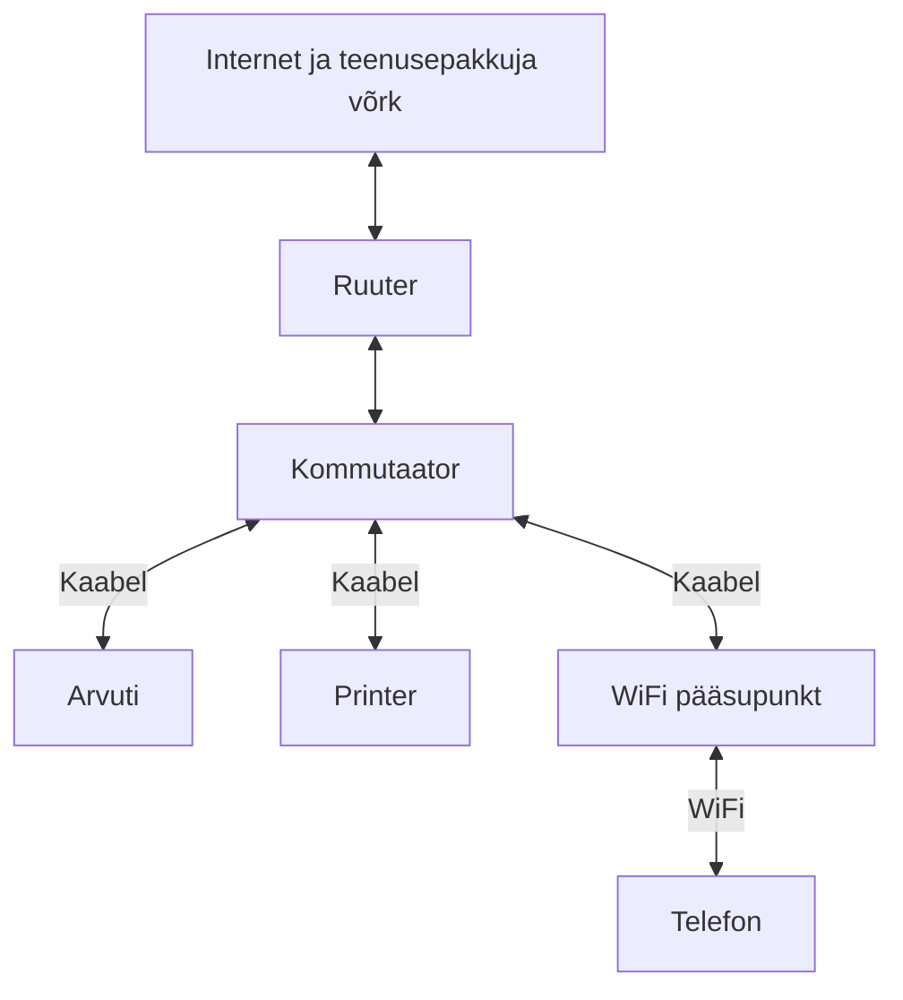

# Võrgu toimimine

Kui avad telefonis veebilehe, saadad dokumendi printerisse või maksad poes pangakaardiga, kasutad tavaliselt arvutivõrku. Võrk võimaldab seadmetel andmeid vahetada. Selles materjalis uurime, kuidas erinevad kohalik võrk, WiFi ja internet, milliseid seadmeid ühendamiseks kasutatakse ning kuidas seade vajaliku sihtkoha leiab.

!!! info "Õpieesmärgid"

    Pärast materjali läbimist oskad:

    - tuua näiteid arvutivõrgu kasutamisest kodus ja tööl;
    - eristada kohalikku võrku, WiFi ühendust ja internetti;
    - selgitada ruuteri, kommutaatori ja pääsupunkti ülesandeid;
    - eristada seadmel LAN- ja WAN-portide otstarvet;
    - selgitada IP-aadressi, vaikelüüsi, DNS-i ja DHCP põhiülesannet;
    - kirjeldada lihtsa näite abil seadme ühendust internetiga.

## 1. Milleks on arvutivõrku vaja?

**Arvutivõrk** on omavahel ühendatud seadmete kogum, milles saab andmeid vahetada. Võrgus võivad olla arvutid ja telefonid, aga ka printerid, telerid, turvakaamerad ning kassaseadmed.

Võrku kasutatakse näiteks ühise printeri kasutamiseks, failide jagamiseks, veebiteenuste avamiseks ja videokõnede tegemiseks. Mõni teenus töötab lähedal asuvas seadmes, teine kaugel asuvas serveris. **Server** on seade või tarkvara, mis pakub teistele seadmetele teenust, näiteks edastab veebilehe või hoiab ühiseid faile.

!!! example "Näide: väike kohvik"

    Kohvikus on kassaseade, makseterminal, töötaja arvuti ja võrguprinter. Kassaseade saadab köögiprinterisse tellimuse ning makseterminal suhtleb makseteenusega. Kliendid saavad kasutada külaliste WiFi võrku. Kõik seadmed ei pea saama üksteisele ligi: tööseadmete ja külaliste ühendused võivad olla eraldatud.

Võrguühendusest võib sõltuda terve tööprotsess. Kui ühendus katkeb, tuleb esmalt aru saada, milline osa ei tööta: üks seade, kohalik võrk või ühendus internetiga.

## 2. Kohalik võrk, kaabelühendus, WiFi ja internet

**Kohalik võrk** ehk **LAN** (*local area network*) ühendab piiratud keskkonna seadmeid, näiteks kodus, klassiruumis või ettevõttes. Kohaliku võrgu sees saab kasutada seal asuvaid teenuseid.

**Ethernet** on levinud tehnoloogia seadmete ühendamiseks kohalikus võrgus. Selles kursuses kasutame Etherneti ühenduseks keerdpaarkaablit. **WiFi** võimaldab seadme ühendada võrku raadioühenduse kaudu, ilma seadme ja pääsupunkti vahelise kaablita.

**Internet** on ülemaailmne omavahel ühendatud võrkude süsteem. Veebilehed on üks internetis kasutatavatest teenustest; internetti kasutatakse ka näiteks e-posti ja videokõnede jaoks.

| Mõiste | Mille kohta see käib? | Näide |
| --- | --- | --- |
| Kohalik võrk ehk LAN | Seadmete võrk piiratud keskkonnas. | Kodus omavahel ühendatud arvuti, telefon ja printer. |
| Etherneti kaabelühendus | Seadme ühendamise tehnoloogia. | Lauaarvuti on võrgukaabliga kommutaatori küljes. |
| WiFi | Juhtmevaba ühendamise tehnoloogia. | Telefon ühendub pääsupunktiga raadio teel. |
| Internet | Omavahel ühendatud võrkude ülemaailmne süsteem. | Koduvõrgust pääseb internetis asuva veebiserverini. |

!!! tip "WiFi ühendus ei tähenda automaatselt internetiühendust"

    Telefon võib olla pääsupunktiga ühendatud ka siis, kui ruuteri ühendus internetiteenuse pakkujaga on katkenud. WiFi märgi olemasolu ei kinnita, et veebilehed avanevad.

!!! example "Näide: internet puudub, printer töötab"

    Teenusepakkuja ühenduses on rike. Koduarvuti ja kohalik võrguprinter on siiski omavahel ühendatud. Kohalikku printimist toetava seadistuse korral saab arvutist printida ka internetita. Pilveteenusest sõltuv printimisviis võib aga vajada internetti.

## 3. Milliseid seadmeid võrgus kasutatakse?

**Kliendiseade** on näiteks telefon või arvuti, millega teenust kasutad. Selle **võrguadapter** võimaldab võrku ühenduda. Arvutil võib olla eraldi adapter kaabelühenduse ja WiFi jaoks.

**Kommutaator** ehk **switch** ühendab kohaliku võrgu seadmeid ja suunab nende vahel andmeid. See on kasulik, kui kaabliga on vaja ühendada mitu arvutit, printer või pääsupunkt.

**Ruuter** ehk **router** ühendab erinevaid võrke ja suunab andmeid nende vahel. Kodus ühendab see tavaliselt koduvõrgu teenusepakkuja võrguga, mille kaudu pääseb internetti.

**WiFi pääsupunkt** ehk **access point** võimaldab juhtmevabadel seadmetel kohalikku võrku ühenduda. Eraldi pääsupunkt on sageli kaabliga kommutaatori või ruuteri küljes.

Teenusepakkuja ühenduse kasutamiseks võib vaja minna ka **modemit** või optilise ühenduse lõppseadet ehk **ONT-d**. Seadme tüüp sõltub sellest, kas ühendus tuleb näiteks kaabeltelevisiooni-, telefoni- või valguskaabli kaudu. Mõni lõppseade täidab ka ruuteri ülesandeid.

!!! tip "Üks karp võib täita mitut ülesannet"

    Kodune „WiFi ruuter” sisaldab sageli ruuterit, mitme LAN-pordiga kommutaatorit ja WiFi pääsupunkti. Antennid ja mitu kaablipesa ei tähenda, et tegemist oleks ainult ühe funktsiooniga seadmega.

### Ühenduste skeem

Järgmises näites on ruuter, kommutaator ja pääsupunkt eraldi seadmed. Telefon ühendub juhtmevabalt, arvuti ja printer kaabliga.

Skeem näitab ühenduste ülesehitust, mitte kõiki andmete edastamise samme. Teenusepakkuja modem või ONT on siin lihtsuse huvides välja jäetud.

### LAN- ja WAN-pordid

**Port** tähendab siin seadme füüsilist ühenduspesa. Ruuteril võivad võrgukaabli pesad olla märgistatud järgmiselt.

| Märgistus | Tavapärane otstarve |
| --- | --- |
| LAN | Arvuti, kommutaatori või muu kohaliku võrgu seadme ühendamine. |
| WAN või Internet | Ühendus teise võrguga, tavaliselt teenusepakkuja poole. |

Portide täpne otstarve sõltub seadme seadistusest. Ka pesa värv ei ole kõikidel tootjatel sama tähendusega. Õppeseadmel kasuta õpetaja juhist ja pordimärgistusi.

Pesa juures olev märgutuli võib näidata füüsilise ühenduse olemasolu või andmeliiklust. Märgutule täpne tähendus on kirjas seadme juhendis. Põlev tuli ei kinnita veel, et internet töötab.

## 4. Kuidas seade võrgus õige sihtkoha leiab?

Kaabel või WiFi loob ühenduse, kuid seade vajab ka võrguseadeid. Alguses piisab nelja mõiste otstarbe mõistmisest.

| Mõiste | Ülesanne | Õppenäide |
| --- | --- | --- |
| IP-aadress | Aadress, mida kasutatakse võrgus andmete suunamiseks. | Arvuti aadress on `192.168.1.25`. |
| Vaikelüüs | Seade, mille kaudu jõutakse tavaliselt teistesse võrkudesse. Seadetes näidatakse selle IP-aadressi. | Vaikelüüsi aadress on `192.168.1.1`. |
| DNS | Aitab domeeninime järgi leida vajaliku IP-aadressi. | Brauser kasutab veebilehe nimele vastava aadressi leidmist. |
| DHCP | Võimaldab saada IP-aadressi ja muud vajalikud võrguseaded automaatselt. | Telefon saab ühendudes võrguseaded DHCP-serverilt. |

### IP-aadress

**IP-aadress** on täpsemalt võrguliidese aadress. Alguses võime sellest rääkida kui seadme aadressist võrgus. Sama arvuti WiFi ja kaabelühenduse aadressid võivad olla erinevad ning aadress võib võrku vahetades muutuda.

Levinud **IPv4-aadress** koosneb neljast punktidega eraldatud arvust, näiteks `192.168.1.25`. Kasutusel on ka **IPv6**, mille aadressi kuju on teistsugune. Selles tunnis uurime eelkõige IPv4 näiteid.

Koduvõrgus kasutatakse sageli privaatseid aadresse, näiteks `192.168.1.25`. Selline aadress võib esineda ka kellegi teise koduvõrgus. Seda ei kasutata internetis ülemaailmse sihtaadressina. Internetiühendusel võib olla ka avalik IP-aadress; see ei pea olema sama, mida arvuti kohaliku ühenduse seadetes näitab.

### Vaikelüüs

Kui arvuti tahab suhelda teises võrgus oleva seadmega, vajab ta sobivat ühendusteed. Tavalises koduvõrgus saadetakse selline liiklus ruuterile, mida kasutatakse **vaikelüüsina** (*default gateway*).

Üldjuhul ei ole vaikelüüsi vaja samas kohalikus võrgus oleva printeriga suhtlemiseks. Internetis asuva serveri poole pöördumiseks kasutatakse tavaliselt vaikelüüsi.

### DNS

Veebilehe nime on inimesel lihtsam meeles pidada kui IP-aadressi. **DNS** (*Domain Name System*) seob domeeninimed aadresside ja muu teabega. Kui vajalik vastus pole juba seadmele teada, saab seade seda DNS-teenuselt küsida.

DNS aitab sihtkoha aadressi leida. Veebilehe sisu edastab seejärel veebiserver, mitte DNS-teenus.

### DHCP

**DHCP** (*Dynamic Host Configuration Protocol*) võimaldab kliendiseadmel saada vajalikud seaded automaatselt. Kodus töötab DHCP-server sageli ruuteris. Kooli või ettevõtte võrgus võib see teenus töötada eraldi serveris.

!!! example "Näide: telefon ühendub koduvõrku"

    1. Kasutaja valib WiFi võrgu ja ühendub pääsupunktiga.
    2. Telefon saab DHCP abil IP-aadressi ning tavaliselt ka vaikelüüsi ja DNS-i seaded.
    3. Veebilehe avamisel leitakse vajalik aadress DNS-i abil, kui see pole juba teada.
    4. Telefon suhtleb internetis asuva serveriga kohaliku võrgu ja ruuteri kaudu.
    5. Brauser saab veebilehe andmed ja kuvab lehe.

    See on lihtsustatud näide. Koduses seadmes võivad pääsupunkt, ruuter ja DHCP-server paikneda samas karbis.

## 5. Enesekontroll

Vasta kõigepealt ise. Seejärel ava vastus ja võrdle oma põhjendust.

### 1. Telefon näitab WiFi ühendust, kuid veebilehed ei avane. Kas internet kindlasti töötab?

??? success "Vaata vastust"

    Ei. Telefon võib olla pääsupunktiga ühendatud, kuid probleem võib olla näiteks internetiühenduses, DNS-is või veebiteenuses. WiFi ühendus ja interneti kättesaadavus on erinevad asjad.

### 2. Mille poolest erinevad kommutaator ja ruuter?

??? success "Vaata vastust"

    Kommutaator ühendab kohaliku võrgu seadmeid ja suunab nende vahel andmeid. Ruuter ühendab erinevaid võrke ning suunab andmeid nende vahel.

### 3. Kas kodune WiFi ruuter võib teha ka kommutaatori tööd?

??? success "Vaata vastust"

    Jah. Kodune seade ühendab sageli ruuteri, kommutaatori ja pääsupunkti ülesanded. Selle LAN-portidesse saab ühendada mitu kaabliga seadet.

### 4. Millisesse porti ühendaksid tavaliselt koduruuteri külge lauaarvuti?

??? success "Vaata vastust"

    LAN-porti. WAN- või Internet-port on tavaliselt mõeldud ühenduseks teenusepakkuja poole. Alati tuleb arvestada konkreetse seadme märgistust ja seadistust.

### 5. Miks saab telefon tavaliselt võrku ühenduda ilma IP-aadressi käsitsi sisestamata?

??? success "Vaata vastust"

    DHCP võimaldab saada IP-aadressi ja muud vajalikud võrguseaded automaatselt. Koduvõrgus pakub seda teenust sageli ruuter.

### 6. Kas DNS saadab brauserile veebilehe sisu?

??? success "Vaata vastust"

    Ei. DNS aitab domeeninime järgi aadressi leida. Veebilehe sisu edastab veebiserver.

### 7. Kas sama kohaliku võrgu printeri kasutamine nõuab alati internetti?

??? success "Vaata vastust"

    Ei. Kohalik printimine võib töötada ka internetita, kui võrguühendus ja printimise seadistus seda võimaldavad. Pilveteenusest sõltuv lahendus võib siiski internetti vajada.

## Kokkuvõte

- Võrk võimaldab seadmetel andmeid ja teenuseid kasutada.
- Kohalik võrk ühendab näiteks kodu või töökoha seadmeid; internet ühendab võrke üle maailma.
- Ethernet ja WiFi on seadmete võrku ühendamise tehnoloogiad.
- Kommutaator ühendab kohaliku võrgu seadmeid, ruuter erinevaid võrke ning pääsupunkt võimaldab WiFi ühendust.
- IP-aadress aitab andmeid adresseerida, vaikelüüs jõuda teistesse võrkudesse ja DNS leida nime järgi aadressi.
- DHCP võimaldab võrguseaded automaatselt saada.

### Mõtle õpitule

1. Nimeta kaks võrgu kasutusviisi oma tulevasel töökohal. Milline neist vajaks tõenäoliselt internetti?
2. Selgita kaaslasele, miks WiFi ja internet ei ole sama asi.
3. Leia õppeseadmel LAN- ja WAN-pordid ning põhjenda nende kasutamist.

## Teema sõnastik

| Mõiste | Selgitus |
| --- | --- |
| Arvutivõrk (*computer network*) | Ühendatud seadmete kogum, milles saab andmeid vahetada. |
| Kohalik võrk; LAN (*local area network*) | Näiteks kodu, kooli või ettevõtte seadmeid ühendav võrk. |
| Ethernet | Levinud kohaliku võrgu tehnoloogia; kursuses kasutatakse kaabliga Etherneti ühendusi. |
| WiFi | Juhtmevaba võrguühenduse tehnoloogia. |
| Internet | Ülemaailmne omavahel ühendatud võrkude süsteem. |
| Kliendiseade (*client device*) | Seade, millega kasutaja võrgu teenuseid kasutab. |
| Server (*server*) | Seade või tarkvara, mis pakub teistele seadmetele teenust. |
| Võrguadapter (*network adapter*) | Seadme osa, mis võimaldab võrguühendust. |
| Kommutaator (*switch*) | Kohaliku võrgu seadmeid ühendav ja nende vahel andmeid suunav seade. |
| Ruuter (*router*) | Erinevaid võrke ühendav ja nende vahel andmeid suunav seade. |
| Pääsupunkt (*access point*) | Võimaldab juhtmevabadel seadmetel võrku ühenduda. |
| WAN (*wide area network*) | Laiemat ala ühendav võrk; koduruuteri WAN-port on tavaliselt teenusepakkuja ühenduse jaoks. |
| IP-aadress (*IP address*) | Võrguliidese aadress andmete suunamiseks. |
| Vaikelüüs (*default gateway*) | Vaikimisi kasutatav tee teistesse võrkudesse, tavaliselt kohaliku ruuteri kaudu. |
| DNS (*Domain Name System*) | Süsteem, mis seob domeeninimed aadresside ja muu teabega. |
| DHCP (*Dynamic Host Configuration Protocol*) | Võimaldab seadmel saada võrguseaded automaatselt. |

## Allikad ja lisalugemine

1. [Cisco: Networking basics](https://www.cisco.com/site/us/en/learn/topics/small-business/networking-basics.html){ target="_blank" rel="noopener" } — võrguseadmete ülesanded.
2. [Cisco: What is a switch vs a router](https://www.cisco.com/site/us/en/learn/topics/small-business/network-switch-vs-router.html){ target="_blank" rel="noopener" } — kommutaatori ja ruuteri erinevus.
3. [RFC 2131: Dynamic Host Configuration Protocol](https://www.rfc-editor.org/rfc/rfc2131){ target="_blank" rel="noopener" } — DHCP tehniline kirjeldus lisahuvilistele.
4. [RFC 1034: Domain names — concepts and facilities](https://www.rfc-editor.org/rfc/rfc1034){ target="_blank" rel="noopener" } — DNS-i tehniline kirjeldus lisahuvilistele.
5. [RFC 1918: Address Allocation for Private Internets](https://www.rfc-editor.org/rfc/rfc1918){ target="_blank" rel="noopener" } — privaatsed IPv4-aadressid.

**Järgmine materjal:** [Oma võrguühenduse uurimine](02_oma_vorguuhenduse_uurimine.md).

---
*Õppematerjali koostaja: Priit Paap, 2026*
